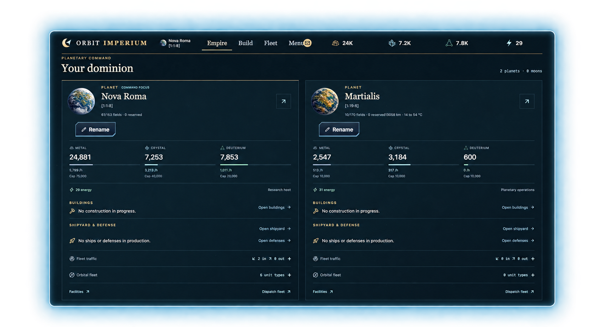

# Orbit Imperium

Build your first planet into an empire. Research new technologies, scout your
neighbors, and send fleets across a persistent multiplayer universe—all in your
browser. You can't buy your way ahead.

**[Play Orbit Imperium →](https://orbitimperium.com/)** ·
[Join us on Discord](https://discord.gg/AVMHp7jUcw) ·
[Run your own universe](#run-your-own-universe)

[](https://orbitimperium.com/)

## What you can do

- **Build an economy.** Develop mines, balance energy, and turn your planet's
  resources into buildings, research, ships, and defenses.
- **Plan your next move.** Research technologies, scout other planets with
  espionage probes, and decide where to send your fleets.
- **Fight for your place.** Raid other players, defend your planets, and read
  combat reports to see how your fleet held up.
- **Expand beyond your homeworld.** Research Astrophysics, build Colony Ships,
  and establish new planets. Keep track of them from the Empire overview.
- **Find your people.** Form or join an alliance and get to know the other players
  sharing your universe.

## Why we're building it

We want a space strategy game where your decisions matter and competition stays
fair. No purchased resources, faster queues, or stronger fleets. Every gameplay
advantage is earned.

We're building Orbit Imperium in the open. You can read the game rules, report
what feels wrong, and help improve it. You can also run your own universe, choose
its configuration, and play with your own community.

## Start playing

1. Open **[Orbit Imperium](https://orbitimperium.com/)** in your browser.
2. Create or sign in to your unbought games account and join a universe.
3. Start developing your homeworld: build your resource production, keep an eye
   on energy, and work toward your first research and ships.

There's nothing to install. If you get stuck, find a bug, or want to talk about
what should come next, **[join us on Discord](https://discord.gg/AVMHp7jUcw)**.

## Open beta and updates

Orbit Imperium is in open beta. It's early, the game is incomplete, and the
official universe may be reset before the full public launch.

Read **What's new** in the game for updates, or browse the
[release notes](docs/news/releases/). Self-hosters can find the latest numbered
release on [GitHub Releases](https://github.com/unbought-games/orbit-imperium/releases/latest).
Pull a numbered container for Linux amd64 or arm64 (Docker selects your architecture):

```sh
docker pull ghcr.io/unbought-games/orbit-imperium:0.4.0
```

The release's `container-image.json` records immutable index and platform digests.
Downloadable amd64 archives and checksums remain available on GitHub Releases.
See [release distribution](docs/operations/open-source-releases.md) for recovery,
digest pinning, and package visibility setup.

Numbered releases and updates to the official server are published separately;
available features also depend on the universe's active rules.

## Run your own universe

You can run an independent universe with local accounts and your own settings.
You'll need Rust, Node.js/npm, Make, and Docker Compose; the
[setup guide](docs/development.md#requirements) lists the pinned versions.

From a checkout of this repository:

```sh
make dev
```

Open the URL printed by Make and sign in with **user/password**. The local
playground includes eight developed planets and nearby bots. Repeating `make dev`
resumes your progress; `make dev-reset` restores the current playground. Use
`./orbit world --help` to inspect and edit it, or apply a JSON batch with
`./orbit world scenario apply edits.json`.

For an independently managed database, `orbit setup --name "Friends" --speed 3`
provides repeatable setup; see the
[setup command](docs/operations/universe-configuration.md#repeatable-setup).

For a public server, follow the [production setup guide](docs/operations/signup.md)
and [universe configuration guide](docs/operations/universe-configuration.md).
The [rules update guide](docs/operations/rules-updates.md) explains how to activate
new content without replacing player progress.

Fresh setup includes the standard content bundled in the server. After updating
every server process to a new image, upgrade an existing universe with the same
binary and database configuration:

```sh
orbit rules upgrade --dry-run
orbit rules upgrade
```

The preview is optional. The command selects the sole universe; use `--universe UUID`
when there are several. Customized values in content being upgraded produce an
explicit conflict instead of being overwritten. No Node.js or source checkout is
needed to run these commands inside the game image.

## Help build Orbit Imperium

Playing and telling us what feels confusing is useful, too. Share feedback on
[Discord](https://discord.gg/AVMHp7jUcw), report a reproducible bug in
[GitHub Issues](https://github.com/unbought-games/orbit-imperium/issues), or open a
pull request. For larger changes, start a discussion in an issue so we can agree
on the direction before you build it.

The game uses Rust, PostgreSQL, React, and TypeScript. Start here:

- [Development and self-hosting](docs/development.md): setup, hot reload, project
  layout, tests, and deployment.
- [Technical documentation](docs/README.md): architecture, game configuration,
  and operator guides.
- [Engineering principles](docs/engineering-principles.md) and
  [conventions](docs/engineering-conventions.md): how we structure changes.
- [Release preparation](docs/operations/open-source-releases.md): numbered
  releases and publication.

### Licensing

Code, tooling, and game rules are licensed under **AGPL-3.0-only**. Documentation
and ordinary game artwork are **CC BY-SA 4.0**. Names, logos, and third-party
materials have separate terms; see [LICENSE](LICENSE) for the full scope.

Built by [unbought games](https://unbought.games/) and contributors.

Empire insignia collections support local files or S3-compatible asset storage.
See [customization setup](docs/operations/empire-customization.md) for persistent
volumes, horizontal hosting, and optional supporter access.
