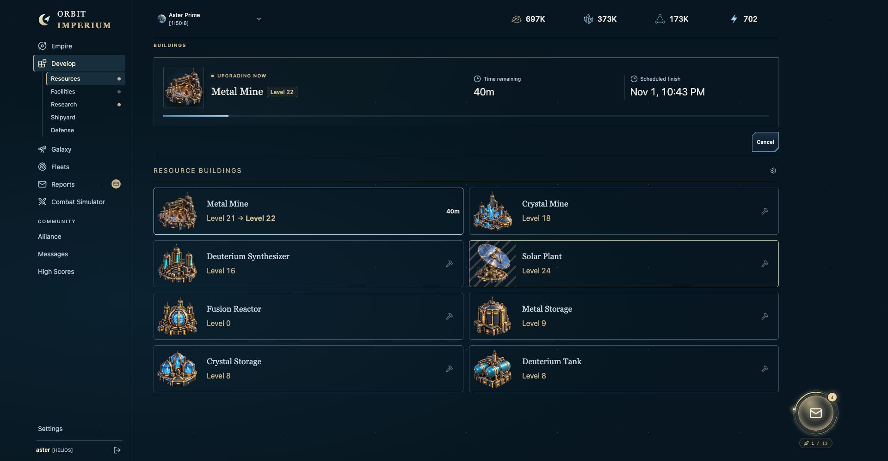
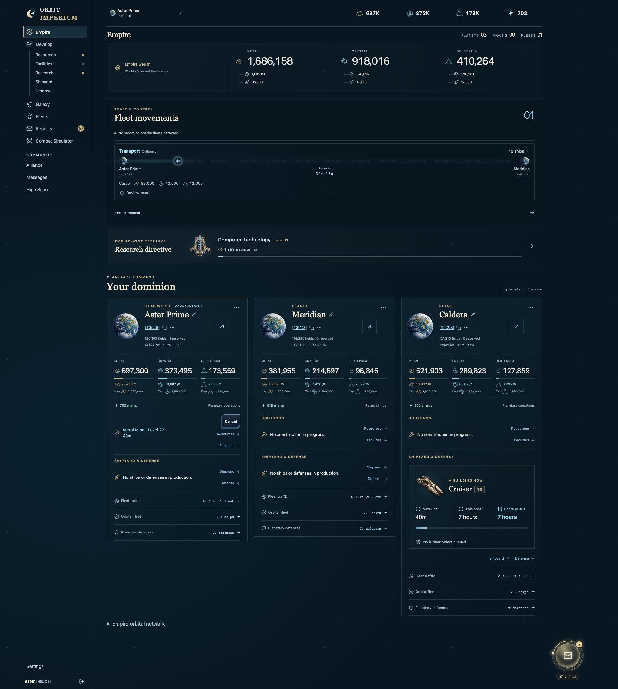
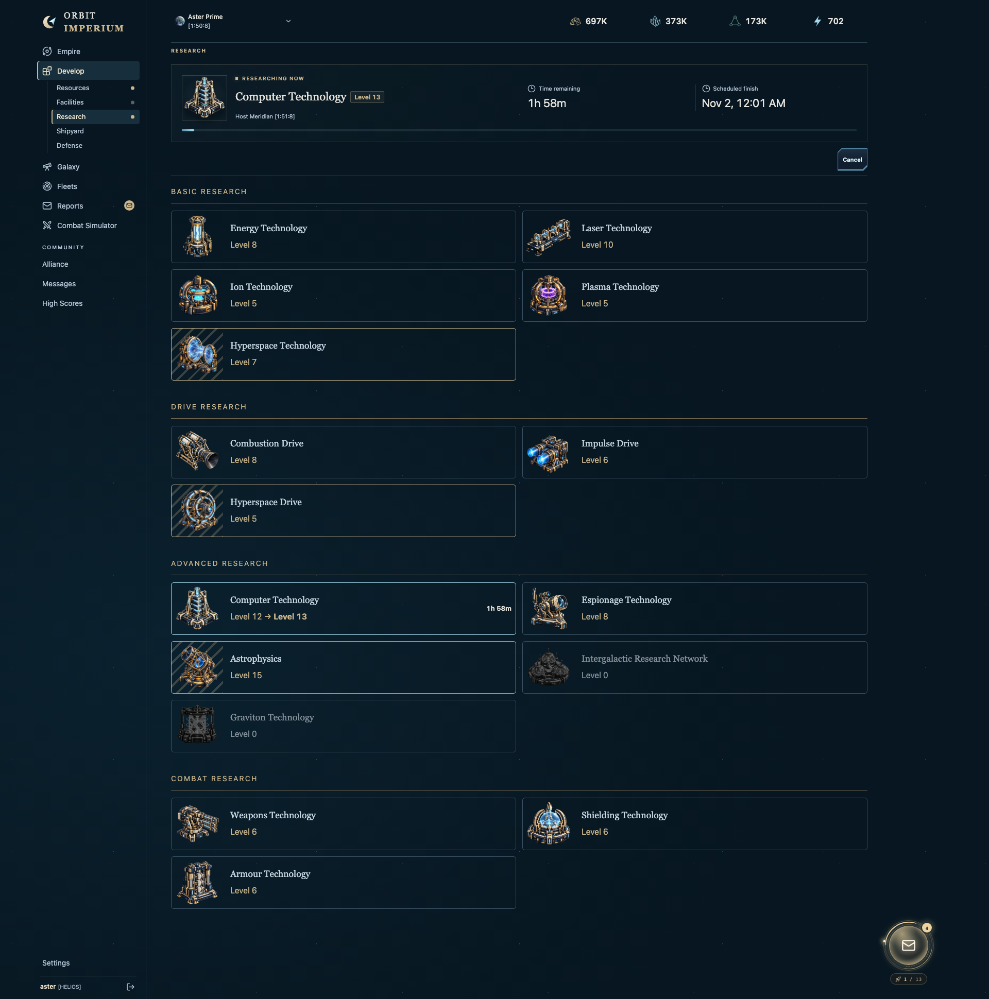
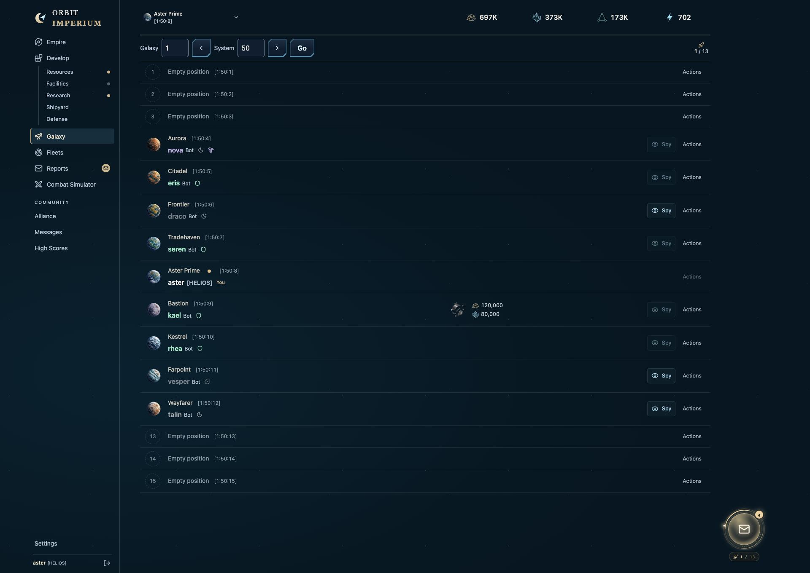
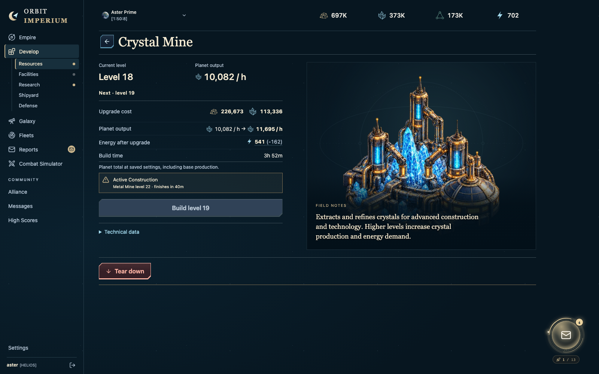

# Orbit Imperium

An open-source, self-hostable multiplayer space strategy game inspired by OGame.
Build your first planet into an empire, research new technologies, and send fleets
across a persistent universe. **Victory isn’t for sale.**

**[Play free →](https://orbitimperium.com/)** ·
[Discord](https://discord.gg/AVMHp7jUcw) ·
[Star on GitHub](https://github.com/unbought-games/orbit-imperium) ·
[Self-host](#run-your-own-universe) ·
[Contribute](#help-build-orbit-imperium)

Play in your desktop or mobile browser. No download, no purchased resources,
no paid speedups. The universe keeps moving while you're offline.

[](https://orbitimperium.com/)

_Build the economy behind your next fleet. Screenshots show a local demo universe._

## Start playing

1. **[Create your empire](https://orbitimperium.com/)** — create or sign in to your
   Unbought Games account and join a universe.
2. Develop your homeworld: build resource production, balance energy, and work
   toward your first research and ships.
3. Scout your neighbors, expand to new planets, and find allies. Planning,
   timing, and cooperation matter as much as the size of your fleet.

Orbit is in **active open beta**. The community is small and development is ongoing.
Come help shape it: [Discord](https://discord.gg/AVMHp7jUcw) is where we talk
strategy, answer questions, and work through player feedback.

## What you can do

- **Build an economy.** Develop mines, balance energy, and decide when to invest
  in production, research, ships, or defenses.
- **Plan your next move.** Research technologies, scout with espionage probes,
  and use the combat simulator before committing a fleet.
- **Fight for your place.** Raid rival planets, defend your own, and learn from
  combat reports. The universe doesn't pause when you log out.
- **Expand beyond your homeworld.** Research Astrophysics, build Colony Ships,
  and manage your planets and fleet movements from the Empire overview.
- **Find your people.** Form or join an alliance, coordinate plans, and get to
  know the other players sharing your universe.

<details>
<summary><strong>See more gameplay: Empire, Research, Galaxy, and upgrade planning</strong></summary>

### Manage an empire

Keep track of three planets, cargo in flight, construction, and research from
one overview.



### Choose your research

Invest in propulsion, espionage, colonization, and combat technology. Your next
upgrade competes with the rest of your empire for resources.



### Know your surroundings

Explore nearby planets and choose where to scout. The neighbors shown here are
labeled bots in the demo universe.



### Weigh an upgrade

See the resource cost, production gain, energy demand, and build time before
committing to construction.



These are unretouched captures of the running game with fictional demonstration
accounts. [Screenshot provenance and credits](docs/assets/README.md).

</details>

## Stay involved

If Orbit is your kind of game, there are a few ways to keep it close:

- **Star this repository** to bookmark it and show your interest in the project.
- **[Follow Unbought Games](https://github.com/unbought-games)** on GitHub to keep
  up with our open-source work.
- **[Join Discord](https://discord.gg/AVMHp7jUcw)** to meet players, ask questions,
  and tell us what could be better.
- **Bring a friend.** Share [orbitimperium.com](https://orbitimperium.com/) with
  someone who enjoys persistent strategy, or send them a story from your game.

Read **What's new** in the game, browse [Orbit news and updates](https://unbought.games/news/browse/orbit-imperium/all/),
or subscribe to the [RSS feed](https://unbought.games/feeds/orbit-imperium/all.xml).

## Why we're building it

We want the strategy, rivalry, and community of browser games without purchased
advantages. No paid resources, faster queues, stronger fleets, or exclusive
gameplay tools. Optional supporter memberships and cosmetics help fund the game
without changing the competitive rules.

We're building in the open so you can inspect the rules, improve the game, and
run a universe for your own community. Playing and telling us what feels confusing
is useful, too.

## Run your own universe

Host an independent server with local accounts, your own universe settings, and
PostgreSQL for persistent game state. Players don't need an Unbought Games account
to join your server.

### Host a server

Use a published container or release binary; you don't need Rust or Node.js to
run the container. [GitHub Releases](https://github.com/unbought-games/orbit-imperium/releases/latest)
provides numbered releases, checksums, and image digests. Containers support Linux
amd64 and arm64:

```sh
docker pull ghcr.io/unbought-games/orbit-imperium:0.6.0
```

This downloads the image. Follow the [server setup guide](docs/operations/signup.md)
to connect PostgreSQL, configure your public origin and HTTPS, initialize a
universe with `orbit setup`, and start it with `orbit serve`.
[Universe configuration](docs/operations/universe-configuration.md) covers speed,
size, and signup settings.

For existing worlds, follow the [rules update guide](docs/operations/rules-updates.md)
after updating the server. [Customization setup](docs/operations/empire-customization.md)
covers your own insignia content and persistent asset storage.
[Release distribution](docs/operations/open-source-releases.md) covers digest
pinning and recovery. Numbered releases and official-server updates are published
separately; available features also depend on the universe's active rules.

### Explore locally or develop

Install the [development prerequisites](docs/development.md#requirements)
(Rust, Node.js/npm, Make, and Docker Compose), then:

```sh
git clone https://github.com/unbought-games/orbit-imperium.git
cd orbit-imperium
make dev
```

Open the URL printed by Make and sign in with **user/password**. The local
playground includes eight developed planets and nearby bots. Run `make dev` again
to resume your progress; `make dev-reset` restores the playground.
See the [development guide](docs/development.md) for hot reload, scenario editing,
and tests.

## Help build Orbit Imperium

The game uses **Rust, PostgreSQL, React, and TypeScript**. Reproducible bug reports,
clearer documentation, and code contributions all help.

[Open an issue](https://github.com/unbought-games/orbit-imperium/issues) with what
you expected and what happened, or send a pull request. For larger changes, start
an issue so we can agree on the direction before you build it.

- [Development guide](docs/development.md): setup, project layout, and tests.
- [Technical documentation](docs/README.md): architecture, game configuration,
  and operator guides.
- [Engineering principles](docs/engineering-principles.md) and
  [conventions](docs/engineering-conventions.md): how we structure changes.
- [Release preparation](docs/operations/open-source-releases.md): numbered
  releases and publication.

## Licensing

Code, tooling, and game rules are licensed under **AGPL-3.0-only**. Documentation
and ordinary game artwork are **CC BY-SA 4.0**. Names, logos, and third-party
materials have separate terms; see [LICENSE](LICENSE) for the full scope.

Built by [Unbought Games](https://unbought.games/) and contributors.
