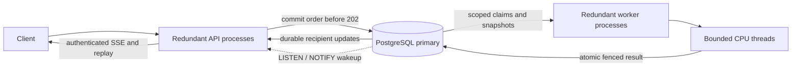

# Concurrent runtime operations

An HTTP acceptance commits a durable order. A worker eventually commits its game-rule outcome; queueing, deployment, or worker failure cannot revoke acceptance. A prediction can differ because an earlier game event changes the facts. Never manufacture an accepted response while its database commit is unknown: retry the original command ID.

This runbook prepares a deployment. It does not claim these resources exist or that production capacity and database failover have been measured. Record the deployed revisions, workload, connection limits, and observed failure/recovery results when validating a deployment.

## Processes and authority

Run the same image as separate OS processes with `ORBIT_ROLE=api` and `ORBIT_ROLE=worker`. Each process has independent memory. `combined` runs both roles in one process for development. PostgreSQL is the shared authority; there is no in-memory command queue whose loss can erase an order.



API instances serve committed snapshots during catch-up. Workers claim complete player/location scopes, renew their 15-second leases every five seconds, compute without holding a database connection, and validate ownership immediately before publication. Independent scopes execute concurrently; overlapping work retains chronological order. A contested player remains a genuine sequential dependency.

One PostgreSQL listener per API process wakes recipient-specific stream subscribers. Notifications are hints; committed update rows and receipts are the recovery path. Session revocation wakes the affected account's streams so they reauthorize and close. Reconnection works through any healthy API instance without affinity.

## Configuration and connection budget

| Setting | API example | Worker example | Meaning |
|---|---:|---:|---|
| `ORBIT_ROLE` | `api` | `worker` | Process responsibility |
| `ORBIT_POOL_ADMISSION` | 8 | 0 | Command/session writes and enrollment |
| `ORBIT_POOL_READS` | 8 | 0 | Reads, authentication lookup, stream replay |
| `ORBIT_POOL_REFRESH` | 2 | 0 | OIDC refresh serialization and remote token exchange |
| `ORBIT_POOL_WORKER` | 0 | 4 | Fact loading, commits, bounded retention |
| `ORBIT_POOL_CONTROL` | 4 | 4 | Guard, coordination, readiness, operational reads |
| `ORBIT_CPU_WORKERS` | unused | 2 | Maximum simultaneous blocking engine calculations |
| `ORBIT_MAX_IN_FLIGHT` | unused | 4 | Maximum claimed engine/barrier jobs |
| `ORBIT_DRAIN_MS` | 25000 | 25000 | Grace for finishing work before release/fencing |
| `ORBIT_METRICS_BIND` | `0.0.0.0:9091` | `0.0.0.0:9091` | Private operational listener, not an internet service |

Configure `DATABASE_URL` on both applications through the deployment secret manager. Set `ORBIT_ORIGIN` to the exact canonical browser origin (for example `https://your-game.example`) on API/combined processes; the localhost default is not a production origin. Set `ORBIT_UNIVERSE_ID` consistently when the database contains multiple universes. Request rate limits use the connection peer IP; clients behind a reverse proxy share its IP-based budget.

Pools connect lazily. Fresh OIDC identities use the read pool. Stale identities use only the refresh pool, with a ten-second deadline covering acquisition through commit and a nonblocking transaction advisory lock per session across replicas. Concurrent refresh attempts fail closed with a recoverable unavailable response. Logout remains free to revoke a session during refresh; a late response cannot recreate it. Local authentication never opens the refresh pool. A zero workload pool is disabled; it cannot borrow another workload's reservation. Every process retains one control connection for the operator guard. API processes retain another for `LISTEN`; API control capacity must be at least three, worker control capacity at least two. Their retained sessions are included in the table, not extra connections.

Two API instances plus two workers reserve **60** connections. One additional instance of each during overlapping rollout raises that to **90**. Budget administration, migrations, monitoring, and PostgreSQL's reserved connections separately. Recalculate before scaling any replica count or pool limit; a 100-connection primary is only an illustrative budget, not a capacity recommendation. Use a direct primary endpoint or session pooling: the retained advisory guard and `LISTEN` require stable database sessions. See the [PgBouncer compatibility table](https://www.pgbouncer.org/features.html).

## Retained-world rollout

1. Verify backups and the database durability/promotion policy below. Keep the existing servers running.
2. Before the first deployment containing migration 0003, build its indexes online from an operator connection:

   ```sh
   psql "$DATABASE_URL" -v ON_ERROR_STOP=1 -f scripts/prepare-runtime-indexes.sql
   ```

   Do not wrap this file in a transaction. Interrupted concurrent builds can leave an invalid index. Inspect `pg_index.indisvalid`; drop only the named invalid index with `DROP INDEX CONCURRENTLY`, then rerun. New empty databases build these indexes in their initial transactional migration. Populated databases refuse the migration until all six indexes are valid, rather than blocking writes during a large startup build. This follows PostgreSQL's [concurrent index behavior](https://www.postgresql.org/docs/16/sql-createindex.html).
3. Apply the compatible schema once with `orbit db-init`. Serving startup still checks and applies a missing compatible tail, but population-dependent preparation is explicit. Never edit an already published migration or its checksum.
4. Deploy the mode-aware bridge to **every** API/combined/worker process while the universe remains serial. No pre-bridge process may remain when scoped execution is enabled. During this initial overlap, older workers do not emit the new delivery obligations; receipt/snapshot reconciliation covers missed notifications. Establish the real-time stream SLO after the bridge rollout is complete.
5. Prepare scheduling declarations in bounded, restartable transactions:

   ```sh
   orbit runtime prepare --universe "$UNIVERSE"
   ```

   New admissions and successors carry declarations while preparation runs. Repeating preparation is safe. Preparing mode also advertises accepted creator references, so complete the bridge rollout before entering it.
6. Activate scoped execution:

   ```sh
   orbit runtime activate --universe "$UNIVERSE"
   ```

   Activation waits outside SQL for the active serial attempt, verifies pending declarations, initializes the native ordering sequence, and atomically fences the serial executor. Accepted inputs, identities, epochs, and event times remain intact. An incomplete preparation must be completed; never bypass the check by editing the mode directly.
7. Roll out separate API and worker processes with the same final image and database, using `ORBIT_ROLE=api` and `ORBIT_ROLE=worker`. For a redundant deployment, verify at least two healthy API processes and two workers, with sufficient capacity while one is draining. Verify actual replica counts and readiness through the host's process manager.
8. Only after every active process supports the intended vocabulary should an operator activate new rules/content. Subsequent compatible rolling deployments retain the scoped mode and restore epoch. Keep enough old healthy API capacity until replacements pass readiness.

Configure the host's stop allowance to exceed application drain grace plus release/runtime shutdown allowances. Host stop allowances are best-effort; abrupt death is recovered through durable claims, not a promise that shutdown always finishes.

A larger player population also needs an appropriately created universe. Process configuration does not change a retained world's rules. A retained 45-slot development universe stays 45 slots. Do not change its topology or reset it to simulate scaling.

## Durability at the database boundary

Worker recovery tests prove application-process durability. They do not prove database failover durability. Production acceptance requires durable WAL on the primary **and on storage eligible for promotion**, with a failover controller that fences the old primary and never promotes a replica missing acknowledged transactions.

Verify `fsync`, synchronous standby membership, `synchronous_commit`, and the provider's actual promotion policy. PostgreSQL `synchronous_commit=on` with configured synchronous standbys waits for durable standby flush; `remote_apply` additionally waits for replay. `remote_write`, asynchronous replication, a volume, and backups alone do not establish zero loss of acknowledged orders. See [PostgreSQL WAL acknowledgement settings](https://www.postgresql.org/docs/16/runtime-config-wal.html) and [synchronous replication](https://www.postgresql.org/docs/16/warm-standby.html#SYNCHRONOUS-REPLICATION).

Record the verified settings and failover evidence in the validation matrix. During loss of the required durability quorum, an unknown HTTP response remains unknown and is retried with the same ID; the API must not claim acceptance without durable acknowledgement.

## Observe lag without withdrawing healthy APIs

`ORBIT_METRICS_BIND` exposes `/metrics`, `/health/live`, and `/health/ready` on a separate listener. Scrape the metrics listener privately and expose only the game listener publicly. Do not configure a public service for the metrics port. `/health/ready` checks structural compatibility and storage access, not zero backlog or unblocked simulation scopes.

Metrics use bounded stage/event labels and universe-level gauges, never player IDs or payloads:

- `orbit_oldest_pending_age_seconds`: age of the oldest due unresolved command/event, including claimed work.
- `orbit_oldest_due_lag_seconds`: age of the oldest overdue scheduled event. Future deadlines are excluded.
- `orbit_blocked_scopes`: durable scope diagnostics requiring investigation.
- `orbit_runtime_seconds`: HTTP admission/read handling, pool checkout, admission ordering gates, final commit gates, CPU queue/work, dependency wait, logical settlement latency, and commit-to-replay latency.
- `orbit_runtime_events_total`: committed inputs, recovered claims, rejected stale commits, storage retries, blocked scopes, HTTP 5xx responses, and engine starts/finishes.
- `orbit_engine_active`, `orbit_db_pool_connections`, and `orbit_runtime_status_available`: process resource use and diagnostic availability.

Pool checkout timing excludes the `BEGIN` round-trip. Settlement is measured against the original logical input time; it includes catch-up delay. Delivery measures commit-to-replay-read time, including clients resuming older cursors; it is not a client network acknowledgement. Engine activity and CPU queue time separate calculation saturation from database waits. Inspect PostgreSQL/WAL, query plans/rows/bytes, storage growth, replication delay, and autovacuum through database monitoring as well.

Use maximum gauges across replicas for a universe, not their sum. Sum the rate of committed-input counters across workers to measure drain throughput. Starting alert objectives, to calibrate against the authorized capacity run:

- Any sustained HTTP 5xx during normal traffic, or a blocked scope with an accepted order.
- Oldest due lag above five seconds for one minute, or a backlog whose age keeps increasing.
- Admission p99 above 150 ms or reads p99 above 200 ms under the declared workload.
- CPU lanes continuously full with increasing queue time, or sustained pool/ordering waits.
- Repeated claim recovery outside deployment, unavailable metrics, or growing database/WAL storage.

These are operational objectives, not measurements already achieved. Adding API replicas increases admission/read capacity; adding workers increases independent simulation capacity. Neither removes a genuine conflict on one contested scope.

## Rules, repair, rollback, and retention

Scoped rules activation is a durable global boundary. Earlier inputs settle first; later work waits behind it while API admission and committed reads continue. The operator may receive a pending activation ID after the CLI's observation window. Retry the same document to observe the same activation; disconnecting the CLI does not cancel it. Enrollment waits outside SQL for an existing configuration boundary so a new player cannot be initialized under obsolete terms. See [rules operations](rules-updates.md).

For a stranded scope, inspect its persisted diagnostic, the original pending input and declared scopes, and the relevant authoritative facts. Deploy a compatible engine fix or make a reviewed repair backed by authoritative evidence. Reconcile with the explicit audit where appropriate. Only then clear the affected diagnostic and increment/fence its ownership metadata in canonical scope order. Preserve the accepted input, ID, logical timestamp, randomness, and receipt. Never turn an engine fault into a gameplay rejection, delete the command to clear lag, or skip it to run a later conflicting command.

After scoped activation, rollback is limited to binaries that understand scoped claims, fences, rules, and the retained schema. Do not set the executor back to serial or run a pre-bridge binary. Roll forward when the older executable cannot interpret the authority. A deliberate restore is a separate epoch-changing operation, never part of a rolling deployment.

Update notifications retain seven days and are pruned in bounded batches. Expired cursors reset to snapshots plus durable receipts; another device consuming a stream never deletes its history. Canonical receipts/idempotency and transition evidence are retained independently. Monitor their storage cost at the target historical population; notification pruning is not permission to discard accepted-order identity.
