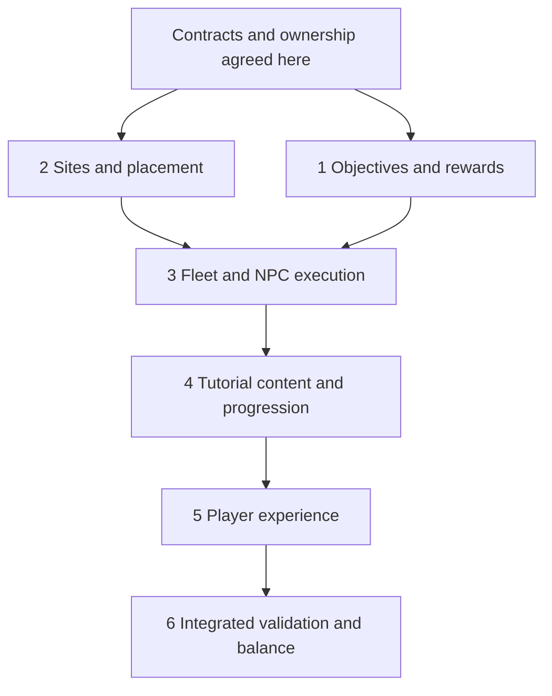

# Onboarding operations: implementation outline and fresh-context handoff

Status: **all six chats complete and integrated acceptance passed.** Read the [final delivery](2026-11-04-onboarding-delivery.md) for behavior, verification, source identity, screenshot inventory and activation. The orchestration/phase reports below preserve history; no implementation owner or runtime job remains active. The owner subsequently requested commit/push on `emick/onboarding-npc-operations`, explicitly without a PR. No live activation/deployment occurred.

## Read first

1. [Consolidated product/technical draft](2026-11-04-onboarding-operations-spec.md): source of truth after owner review.
2. [Decision log](2026-11-04-onboarding-decisions.md): explicit owner choices, superseded proposals, current review state.
3. [Research](2026-11-04-npc-operations-research.md): Orion sources, existing-code investigation, provisional timing calculations, and default-change validation.
4. Repository `AGENTS.md`, relevant global skills, and the UI design skill/guide before UI work.

The originating chat remains the integration owner. Continue here after compaction rather than rebuilding the design from old brainstorming. Owner asked to settle requirements, write a spec, review it, record the chat outline, then orchestrate from durable context.

## Critical corrections to preserve

- No skip-and-collect mechanism. Full-interface choice changes presentation only. Rewards require real accomplishments, recognized in normal gameplay as well as the recommended tutorial route.
- Milestone rewards automatically go to the homeworld. No claim button, unclaimed bank, active-body destination, or login-triggered payment.
- Raid loot is separate, physical cargo. Use normal per-resource 50% plunder and surviving capacity, not a special 100% tutorial recovery rule.
- Players build their own economy and ships. No gifted starter fleet by default; no special speedups, insurance, or replacement grants.
- Two distinct, personal, nearly orbital sites; create lazily only for humans in beginner presentation at the relevant uncompleted lesson. Bots and full-interface players earn the same objectives without automatic sites.
- Existing empires qualify through new activity after launch. Do not build historical replay/backfill or force beginner mode.
- Chapters provide tight early guidance and progressive UI disclosure, then open the full game. Later defense, espionage, PvP, and colony chapters are future content.
- Sites should retire promptly. One-lesson retirement and exact success/debris semantics are proposed defaults awaiting review, not universally imposed NPC behavior.
- 3x fresh default is already changed locally. 2x is a primary balance case. The current build-sequence estimates are about 53/79 minutes through a second orbital return, not a promised 30-minute experience.
- Do not implement the future campaign catalog. Preserve definition/run/view, actor/beneficiary, placement/disclosure, and program/universe lifecycle boundaries.

## Current local workspace state

This section records the pre-orchestration snapshot. For current implementation,
validation and exact next-chat APIs, read the [foundation checkpoint](2026-11-04-onboarding-foundation-checkpoint.md)
and [active orchestration record](2026-11-04-onboarding-foundation-orchestration.md).

Workspace: `/Users/ethan/.codex/worktrees/d2d8/orbit-imperium`.

Inspected base revision: `a4b2dcab0847182244c0afae1f5783c6a9a27b33`. Inspect current `git status` and HEAD on resume; never reset local changes to reproduce this snapshot.

Completed code work is limited to the owner's requested fresh-universe default change:

- `crates/application/src/universe_config.rs`: default speed 3.
- `crates/server/src/universe_cli/parse.rs`: derive omitted CLI speed from the application default.
- `crates/server/src/setup_cli.rs`: help text and default/explicit-speed tests.
- `crates/server/src/universe_cli/tests.rs`, `crates/application/tests/universe_config.rs`: default and explicit overrides; repaired duplicate-key fixture.
- `crates/storage-postgres/tests/rules_speed.rs`, `scripts/speed-updates-e2e.mjs`: pin 5x in fixtures whose purpose is a 5x-to-3x cutover.
- `scripts/rules-updates-e2e.mjs`: expect 3x for the independent newly created default world.
- `Makefile`: focused `test-universe-config` target.
- `docs/architecture/server-speed.md`, `docs/operations/signup.md`, `docs/operations/universe-configuration.md`: new default documentation.

Research, decision log, specification, and this handoff are local documents. No commit, push, PR, deployment, or live-world speed update was performed. No NPC/tutorial implementation exists yet. Compiler outputs are normal local cache artifacts; no disposable database/container/server remains from this work.

### Validation already performed

`make test-universe-config`: 8 application configuration tests and 9 CLI/setup tests passed; 34 unrelated server tests were filtered out. Rust formatting, diff whitespace, and syntax checks on both edited explicit-validation scripts passed.

The initial application run had one explained failure: a duplicate-JSON-key test tried to replace literal speed 5 in a serialized default document that now contained 3. History was inspected; the fixture was repaired once to pin its independent speed and verify the injection target. It then passed. No test was removed or weakened. Full timings and code-diff hashes are in the research note. Database and full-system/browser validation were not run for that default-only change.

Do not rerun broad suites just to reconstruct history. Run checks appropriate to subsequent implementation changes and required repository checks before pushing.

## Delivery structure

Use this chat for contract agreement, integration, and originating PR follow-through. Proposed work consists of six implementation chats. They are dependent parts of one feature, not six unrelated framework projects.

Chats 1 and 2 may execute in parallel once their shared contracts exist. Downstream code should consume integrated foundations in order. Early content drafting or UI sketches are fine, but do not let downstream chats invent incompatible endpoint/type contracts.

### Before starting implementation chats

1. Review specification section 11 with the owner and incorporate any correction. Avoid restarting settled decisions.
2. Record concrete types and boundaries: `SiteId`/destination selection, site placement/issuance/retirement, definition versions, NPC participant identity, operation-fleet references, objective completion evidence, grant identity, resource transfers, and authorized projections. Names are provisional until this contract pass.
3. Settle feature activation and compatibility sequencing against the actual current checkout. Preserve saved JSON and accepted terms; do not give new enum variants to old workers.
4. Assign migration ownership/numbering and shared-file integration order. `world.rs`, `commands.rs`, `state.rs`, `scheduling.rs`, OpenAPI, and generated client contracts are collision points; no simultaneous uncoordinated edits.
5. Preserve the local speed-default work as a distinct logical change when preparing commits. Do not merge it into unrelated rewrites.
6. Only create user-owned chats when explicitly requested. Use the desktop thread tools for those, and include a complete task brief, dependencies, exact checkout/base, and links to these documents. Do not substitute silent subagent spawning for requested user-owned chats.

## Chat 1 — Reusable objectives and milestone rewards

**Owns:** program/definition versions, run binding, typed objective evaluation, causal completion evidence, stable beneficiary/grant identities, automatic homeworld grants, receipt projection, and associated persistence/scopes. This is the shared accomplishment/reward foundation, independent of tutorial navigation or NPC target identity.

**Inputs:** root-agreed gameplay-fact/effect contracts, eligibility policy, authored objective schema, and current ordering/persistence conventions.

**Outputs:** authoritative building/research/manufacturing/combat/return facts can satisfy typed objectives and issue once-only rewards. Out-of-order credit works without old-history reconstruction. Human and bot evaluation is identical. Homeworld delivery works offline and for actions on other bodies. Presentation changes grant nothing. Initial predicate families remain small; unsupported future behaviors fail explicitly.

**Integration ownership:** new objective/program/reward modules, persistence and tests. Root coordinates shared state/changesets, contracts, and migrations. No client-callable award endpoint, arbitrary scripting language, unclaimed bank, or exact tutorial-site assumption.

**Tests:** predicate semantics, minimum-level checks for established players, evidence versus mere ownership, duplicates/unknown commit retries, multiple objectives, versioned definitions without repeat payment, colony/moon selection, offline grants, correct homeworld/scopes, identity/epoch boundaries, deletion under the reviewed grant policy, bot parity, no UI-dependent completion, atomic completion/payment.

**Done:** tested objective/grant APIs and receipt projections are integrated. Chat 3 can feed real encounter/return outcomes into this contract; Chat 4 supplies the actual tutorial definition and orchestration. Keep new behavior disabled until its complete consumer is ready.

## Chat 2 — Mission sites, placement, and finite stockpiles

**Owns:** versioned site definition validation, stable identity, issuance, constrained placement, creation/disclosure separation, access/visibility, finite initial stock and extraction interfaces, retirement, storage, and site conflict scopes.

**Inputs:** root-agreed site, NPC identity, transfer/effect, and retirement contracts. Can run in parallel with Chat 1; this chat owns NPC stock transfers while Chat 1 owns milestone issuance. Shared resource-effect conventions are settled before dispatch.

**Outputs:** a personal site can be issued once, resolved by ID/revision, queried by its authorized player, retired, and restored across restart. Two sites can share an orbital anchor without consuming colony slots. Randomized placement persists once; missing valid candidates fail explicitly. Site extraction conserves its finite stock and cannot duplicate on retries. Real fleet cargo integration follows in Chat 3.

**Integration ownership:** new site modules/storage, stock-transfer logic, and tests. Root coordinates additions to destinations, state, scopes, and migrations. No fake player account, fleet-combat engine, automatic spawning for every empire, or production tutorial content.

**Tests:** duplicate issuance, unauthorized access, wrong universe/epoch, stale revisions, shared anchors, valid placement and no-candidate results, retained placement, partial/exhausted stock, rollback and concurrent extraction, no replenishment, retirement with live references, supported/unsupported policies. A second authored fixture proves definition reuse.

**Done:** integrated site, destination, projection, extraction, and retirement APIs are available to Chat 3, with focused engine/HTTP/database coverage appropriate to its persistence changes.

## Chat 3 — Real fleets and NPC encounter execution

**Owns:** site selection/quotation, launch and arrival dispatch, explicit NPC combat identity, integration with the existing battle calculation, ordinary raid-loot allocation, cargo, recall, return, and retirement races.

**Inputs:** integrated site/stock APIs from Chat 2 and objective/reward contracts from Chat 1. Do not build a second movement engine or inject fake persistent player accounts to satisfy combat metadata.

**Outputs:** a real owned fleet can launch toward a site, encounter a defined force, recover legal loot, and return ships/cargo normally. Accepted terms remain committed; a later drive upgrade does not retroactively alter travel. Authoritative battle/extraction/return facts are available for objectives.

**Integration ownership:** coordinated edits to mission/combat/encounter code and relevant loaders/commit handling. Keep planetary production, defense repair, debris, and moon consequences explicit. Add site-local debris/report facts according to reviewed policy, without accidentally creating public harvest opportunities.

**Tests:** historical player-battle determinism, normal formula reuse, first intended fight safety, second intended fight safety, unfavorable outcomes for unsuitable forces, half-loot/capacity/rounding, two attempts and retry, recall versus arrival, stale events, closing/retired site, return identity, deletion/vacation, no new launches after retirement, accepted flights preserved.

**Done:** complete backend operation round trip and focused HTTP/database coverage; no browser-side award or timing machinery. Runtime behavior works independently of tutorial names.

## Chat 4 — Tutorial chapters, progression, and balance

**Owns:** the first production program definition: three chapters, step explanations, prerequisites/recommendations, exact initial reward amounts, two NPC site definitions, chapter-driven disclosure/retirement, beginner presentation preference, lazy teaching-site issuance, and progression balancing at 2x/3x.

**Inputs:** integrated generic objectives/grants from Chat 1, sites/placement from Chat 2, and real encounter/return outcomes from Chat 3. This chat is a consumer of those systems; it must not implement a second objective evaluator, reward ledger, or fleet lifecycle.

**Outputs:** the economy-first opening is playable through backend APIs. Generic ordinary gameplay earns the same milestones. Existing players/bots have no forced beginner mode or historical backfill. Beginner-mode humans receive sites only when needed. Full-interface selection has no economic or flight effect. Recommendations understand actual prerequisites, resources, active queues, and completed work.

**Integration ownership:** tutorial content definitions, program activation/integration, guidance selectors, and meaningful tests. New generic primitives discovered during integration go back through the owning contract/chat rather than becoming tutorial-name branches in engine modules. No later defense/espionage/colonization chapters in this release.

**Tests/experiments:** complete guided and independent backend journeys; equivalent player-target combat; minimum-level and out-of-order progress; bot parity; lazy issuance/mode toggles; completed milestones suppress unnecessary sites; retirement; first intended fleet safety; resource sufficiency, concurrency of construction/research/manufacture, operating costs, and transition to unsupported-by-grants ordinary play at 2x and 3x. Persist test definitions and measured assumptions so balance is reproducible.

**Done:** final initial chapter content and authorized guidance projections are ready for UI, with actual engine-backed timing/economic evidence and exact reward/stock amounts. Document remaining uncertainty rather than turning arithmetic estimates into playthrough claims.

## Chat 5 — Player experience and visual validation

**Owns:** chapter presentation, gradual interface disclosure, Show full interface, contextual next actions, site briefing/dispatch integration, encounter/return presentation, reward receipts/history, and completion transition.

**Inputs:** integrated authoritative APIs and actual first-content definitions from Chats 1–4. Read UI skill/guide before design or implementation. Inspect current running patterns first.

**Outputs:** a player can complete the guided opening and use the full interface at any time; an independent player earns rewards through ordinary actions. Fleet loot and milestone grants are distinguishable. Retired sites vanish from actionable navigation while flights/reports remain understandable. Receipts acknowledge automatic homeworld payment; no Collect reward button.

**Integration ownership:** feature components/hooks and relevant shell/dispatch/report composition. Reuse shared components; authoritative game state remains in Zustand. No mirrored progress/balances or local timers establishing completion. Coordinate OpenAPI/generated types centrally.

**Tests/inspection:** focused browser navigation/submission/focus/resume coverage using response-aware fixtures; desktop/mobile running screenshots for each changed screen and relevant state; touch/focus/contrast, hidden-navigation escape, offline receipt catch-up, slow/error loading, no accidental economic mode-switch effects. Keep essential alerts visible in beginner mode.

**Done:** inspected final captures after last UI changes, displayed inline in this originating implementation chat before enqueue/merge. Screenshots are not hosted/uploaded to the PR by default.

## Chat 6 — Integrated validation, economic balance, compatibility

**Owns:** cross-boundary acceptance, actual engine timing/economic experiments, release/activation compatibility, and consolidated validation evidence. Every upstream chat still owns its own defects and tests.

**Inputs:** complete feature and approved content, all earlier focused results, final screenshots, current baseline and exact candidate revision.

**Outputs:** evidence for guided and independent end-to-end journeys at 3x and 2x; reasonable continuation when grants end; safe intended encounters; no payout duplication; historical compatibility; deletion/retirement/arrival interactions; correct rollout for existing players and bots.

**Checks:** deterministic event/race schedules, database atomicity, contracts, formatting/lint, required routine suites, and focused browser flows. Full-system/container/recovery/rolling-deployment suites remain explicit-only under repository rules. Do not silently promote them to routine CI or add recurring monitoring.

Record exact revision, setup/build/test/wait timings separately where measurable, failed attempts and repairs, cleanup, and limitations. Follow the one-repair test policy and investigate shared fixture defects; no sleep/retry stabilization. Report only concrete defects, not speculative abstractions.

**Done:** integrated feature ready for the authorized PR/release workflow, with remaining external blockers named precisely. Deployment is a separate user request.

## Integration and orchestration rules

- Reuse suitable attached worktrees; use desktop worktree tools if new ones are required. Branch prefix defaults to `emick/`.
- Before dispatch, each chat gets its owned modules, shared-file coordination rules, prerequisite revisions, success cases, exclusions, and validation commands. Update the briefs if scope changes.
- Prefer stable dependent integration over several chats editing the same mission/state/contracts files in parallel. Parent integration owns cross-cutting API and migration ordering.
- Do not merge partial UI/backend feature activation. It can be landed behind an explicit compatible activation boundary, but both guided and independent paths must be coherent before enabling.
- No unsolicited messages to external services. Chat coordination stays in Codex; use thread tools only when actual chat creation/coordination is requested.
- If asked to push/open/fix a PR, use the applicable PR/finish-pr skills and retain follow-through here. PR titles must be Conventional Commits. Preserve whatever merge authority the user actually gives; do not infer deployment authority.

## Exact next action after a fresh context

1. Read final delivery, this handoff and the spec; inspect current Git status. Preserve the completed foundation and 3x-default work on the delivery branch.
2. Chats 1 and 2 are complete. Their links and reports are in the checkpoint. Do not recreate them or repeat their completed work.
3. All six implementation chats and the supplemental nonoptimal-spend validation are complete. Do not recreate them or repeat successful checks merely to reconstruct history. Read final delivery and Chat 6's acceptance report; verify the source fingerprint if the checkout changed.
4. The current feature includes 27 objectives, three chapters, real NPC fleet operations, automatic rewards, full-interface choice, supported maintenance activation and the full player UI. Future chapters/campaigns and live definition migration remain separate future work.
5. There is no remaining automatic implementation step. On a subsequent PR/release request, use the appropriate skill and preserve scope/merge authority; keep the 3x-default change logically distinct when packaging commits. Activation requires the documented coordinated operator action. Do not deploy or push merely from this historical handoff.
